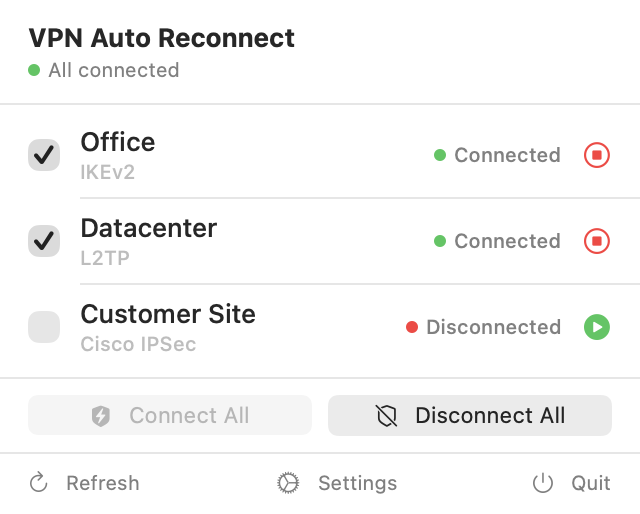
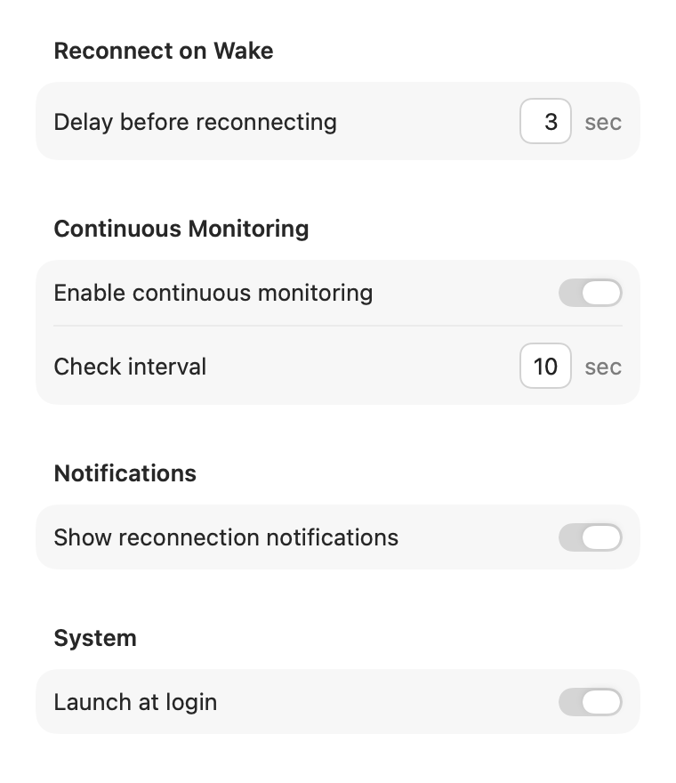

# VPN Auto Reconnect

macOS menu bar app that automatically reconnects your VPNs when your Mac wakes up from sleep.

<p align="center"></p>

- Reconnects the VPNs you select after every wake, one after the other, with retries
- Works with the VPNs configured in System Settings: IKEv2, L2TP/IPSec, Cisco IPSec
- Colored menu bar icon shows the state at a glance: green when all selected VPNs are connected, orange when some are disconnected, red when all are
- Optional continuous monitoring: reconnects a VPN that drops while the Mac is awake
- Connect all / disconnect all from the menu
- Launch at login: when you turn it on, macOS shows a "Background Items Added" notification and lists the app in **System Settings › General › Login Items & Extensions**. This is expected and needs no administrator password
- No Dock icon, nothing to configure besides ticking your VPNs

English and French, following the system language.

## Screenshots

**Menu bar icon** — one look tells you whether your VPNs are up


**Settings** — delay after wake, continuous monitoring, notifications, launch at login



## Install

With [Homebrew](https://brew.sh):

```sh
brew tap cbrassel/tap
brew trust cbrassel/tap   # Homebrew 7 and later
brew install --cask vpnautoreconnect
```

Or download the latest `VPNAutoReconnect-x.y.zip` from [Releases](../../releases), unzip it and move **VPNAutoReconnect** into **Applications**.

The app is signed with a Developer ID and notarized by Apple.

## Requirements

- macOS 14 or later
- At least one VPN configured in **System Settings › VPN**

## Feedback

Please open an [issue](../../issues).
